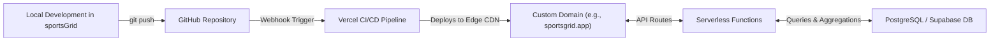

# All-Sports 4×4 Grid: Game Specification & System Architecture

## 1. Executive Summary

**Project Name:** SportsGrid (Working Title)  
**High Concept:** The ultimate 4×4 sports trivia grid that breaks down the silos between major professional leagues. Unlike traditional single-sport grids, SportsGrid unifies the **NFL, NBA, MLB, and NHL** into a single daily 16-cell matrix featuring a rich taxonomy of categories—including cross-sport statistical homonyms (e.g., Steals, Assists, Hits, Points, Saves, Turnovers).

---

## 2. Core Game Mechanics

### 2.1 The Board
* **Dimensions:** 4 rows by 4 columns = **16 total cells**.
* **Coordinates:** $(R_i, C_j)$ where $i \in \{1, 2, 3, 4\}$ and $j \in \{1, 2, 3, 4\}$.
* **Intersections:** Every cell represents the logical conjunction (`AND`) of its row header and its column header.

### 2.2 Guess Constraints & Player Eligibility
1. **Qualification Rule:** To qualify for a team or league, an athlete must have appeared in at least **one official regular-season or postseason game** at the highest professional level. (Pre-season, training camp, practice squads, and minor league stints do not qualify).
2. **Single-Use Rule:** A player cannot be reused across multiple cells on the same board.
3. **Stat Attribution:** Lifetime career stats apply unless the category explicitly specifies a single-season or era milestone (e.g., "Led League in Steals in a Season").

### 2.3 Difficulty / Playstyle Modes
Players can choose their daily playstyle:
* **The Immaculate 16 (Hardcore Mode):** Exactly 16 guesses allowed. Any incorrect guess burns that cell permanently with an `X`. Perfect score is 16/16.
* **4 Strikes (Casual Mode):** Players can keep guessing until all 16 cells are filled or until they accumulate 4 strikes (lives). Ideal for casual fans and experimenting with deep cuts.

---

## 3. The Category Taxonomy

Categories are modular, declarative filter rules classified into six distinct types:

```
[Category Types]
├── 1. LEAGUE / SPORT      (NFL, NBA, MLB, NHL)
├── 2. METRO / MARKET      (Boston, Chicago, New York, Bay Area, LA, etc.)
├── 3. ACCOLADES           (Championship Ring, MVP, Rookie of the Year, Hall of Fame)
├── 4. BACKGROUND/COLLEGE  (SEC, Big Ten, ACC, Pac-12, Undrafted, #1 Overall Pick)
├── 5. NUMBERS & ERAS      (Wore #23 or #24, Played in 3 Decades, Active in 2020s)
└── 6. CROSS-SPORT STATS   (Steals, Assists, Points, Hits, Saves, Turnovers)
```

### 3.1 The 6 Cross-Sport Stat Homonyms
These categories take advantage of identical statistical terminology shared across different sports:

| Stat Name | Sport A (Meaning) | Sport B (Meaning) | Sport C (Meaning) | Example Category Thresholds |
| :--- | :--- | :--- | :--- | :--- |
| **Steals** | **MLB:** Stolen Bases | **NBA:** Defensive Steals | — | `500+ Career Steals`, `Led League in Steals` |
| **Assists** | **NBA:** Passing Assists | **NHL:** Goal Assists | — | `1,000+ Career Assists`, `100+ Season Assists` |
| **Points** | **NBA:** Points Scored | **NHL:** Goals + Assists | **NFL:** Total Points Scored (Kickers/TDs) | `10,000+ Career Points`, `1,000+ Points` |
| **Hits** | **MLB:** Base Hits | **NHL:** Body Checks / Hits | — | `3,000+ Career Hits`, `2,000+ Hits` |
| **Saves** | **MLB:** Pitching Saves | **NHL:** Goalie Puck Saves | — | `300+ Career Saves`, `Led League in Saves` |
| **Turnovers** | **NFL:** INTs + Fumbles Lost | **NBA:** Turnovers Committed | — | `150+ Career Turnovers`, `50+ Season Turnovers` |

---

## 4. Grid Generation & Solvability Guarantee

A multi-sport grid must guarantee that every single cell is solvable with reasonable difficulty.

### 4.1 The Bipartite Solvability Threshold
Let $S(R_i, C_j)$ be the set of valid athletes satisfying both Row $R_i$ and Column $C_j$:
$$\forall i \in \{1,2,3,4\}, \forall j \in \{1,2,3,4\}: \quad |S(R_i, C_j)| \ge 5$$

* If any cell has fewer than 5 valid historical athletes, the generator rejects that row/column combination and regenerates the puzzle.
* **Incompatible Pairings Prevention:** The generator automatically forbids pairing two mutually exclusive Entity Filters (e.g., `[Played in NFL]` × `[Played in NHL]` is blocked because the answer pool is $< 3$ athletes).

---

## 5. Scoring & Badges

### 5.1 Rarity Score (0 to 1600)
* For each cell correctly answered, the player receives a percentage score based on what percentage of all players chose that athlete:
  $$\text{Cell Rarity} = \frac{\text{Guesses for Athlete}}{\text{Total Correct Guesses for Cell}} \times 100$$
* **Total Rarity Score** = $\sum_{k=1}^{16} \text{Cell Rarity}_k$ (Lower is better; 0.0 is the theoretical minimum).
* Unfilled or incorrect cells carry a penalty of `100.0`.

### 5.2 The "Grand Slam" Diversity Bonus
To reward cross-sport mastery in open-category cells:
* If a completed grid contains at least **1 athlete from 4 different sports** (NFL, NBA, MLB, and NHL), the player receives the **Grand Slam Badge** and a **25% deduction** on their final Rarity Score.

### 5.3 Special Badges
* **The Immaculate 16:** 16/16 with 0 incorrect guesses.
* **Deep Cut Specialist:** Average athlete rarity across all 16 cells is under $1.0\%$.
* **Stat Alchemist:** Successfully filled a Cross-Sport Stat cell using the non-obvious sport (e.g., Alex Ovechkin for "Hits", or John Stockton for "Steals" against an MLB-heavy grid).

---

## 6. Technical Architecture & Data Model

### 6.1 Athlete Schema (`Athlete`)
```typescript
export type Sport = 'NFL' | 'NBA' | 'MLB' | 'NHL';

export interface Athlete {
  id: string;                      // e.g. "ath_tom_brady_01"
  name: string;                    // "Tom Brady"
  normalizedName: string;          // "tom brady" (for indexing)
  sports: Sport[];                 // ['NFL']
  teams: string[];                 // ['NE', 'TB']
  markets: string[];               // ['BOS', 'TB']
  positions: string[];             // ['QB']
  activeYears: [number, number];   // [2000, 2022]
  jerseyNumbers: number[];         // [12]
  
  // Background & Education
  college?: string;                // "Michigan"
  collegeConference?: string;      // "Big Ten"
  draftPick?: number;              // 199
  draftRound?: number;             // 6
  draftYear?: number;              // 2000
  isUndrafted: boolean;            // false
  countryOfBirth?: string;         // "USA"

  // Major Accolades
  championships: number;           // 7
  championshipYears: number[];     // [2001, 2003, 2004, 2014, 2016, 2018, 2020]
  mvps: number;                    // 3
  rookieOfTheYear: boolean;        // false
  hallOfFame: boolean;             // false

  // The 6 Normalized Cross-Sport Stats
  stats: {
    steals?: number;               // MLB SB or NBA Steals
    assists?: number;              // NBA / NHL Assists
    points?: number;               // NBA / NHL / NFL Points
    hits?: number;                 // MLB Base Hits or NHL Body Checks
    saves?: number;                // MLB Saves or NHL Saves
    turnovers?: number;            // NFL INTs+Fumbles or NBA Turnovers
  };

  // Season Leader Accolades
  ledLeagueInSteals?: boolean;
  ledLeagueInAssists?: boolean;
  ledLeagueInPoints?: boolean;
  ledLeagueInHits?: boolean;
  ledLeagueInSaves?: boolean;
}
```

### 6.2 Category Schema (`Category`)
```typescript
export type CategoryType = 
  | 'SPORT' 
  | 'METRO' 
  | 'ACCOLADE' 
  | 'BACKGROUND' 
  | 'NUMBER_ERA' 
  | 'CROSS_STAT';

export interface Category {
  id: string;
  name: string;                    // "500+ Career Steals"
  shortName: string;               // "500+ Steals"
  type: CategoryType;
  description: string;
  icon?: string;
  // Deterministic evaluation function
  matches: (athlete: Athlete) => boolean;
}
```

### 6.3 Daily Puzzle Schema (`DailyPuzzle`)
```typescript
export interface DailyPuzzle {
  id: string;                      // "2026-11-08"
  date: string;                    // ISO Date
  rowCategories: Category[];       // 4 categories
  colCategories: Category[];       // 4 categories
  // Pre-calculated solution matrix containing athlete IDs for each cell [row][col]
  solutionMatrix: string[][][];
  totalValidCombinations: number;
}
```

---

## 7. User Experience & Search Interface

### 7.1 Autocomplete Disambiguation
Because the player pool spans all sports, the autocomplete modal must show rich disambiguation metadata for every search result:

```
+-------------------------------------------------------------------------+
| [ Search athlete name...                                          [X] ] |
+-------------------------------------------------------------------------+
|  Adrian Peterson    [NFL]  RB  •  Vikings / Cardinals / Bears  (2007-21) |
|  Adrian Peterson    [NFL]  RB  •  Chicago Bears                (2002-09) |
|  Mike Williams      [NFL]  WR  •  Chargers / Jets / Steelers   (2017-24) |
|  Mike Williams      [NBA]  F   •  Kings / Hawks                (1989-90) |
+-------------------------------------------------------------------------+
```

### 7.2 Shareable Grid Output
Following the viral Wordle / Immaculate Grid pattern, players can copy an emoji grid to clipboard:

```
SportsGrid 4x4 #42 🏆
15/16 | Rarity: 124.8
Grand Slam Bonus: Active 🎯

🟩🟩🟩🟩
🟩🟩🟨🟩
🟩🟩🟩🟩
🟩🟩🟩🟩

Play: https://sportsgrid.app
```

---

## 8. Production Tech Stack

| Layer | Technology | Justification |
| :--- | :--- | :--- |
| **Framework** | Next.js (App Router) + TypeScript | Hybrid SSR/Edge rendering for daily puzzle SEO, fast client transitions, and native API routes. |
| **Styling & UI** | Tailwind CSS + Framer Motion | Snappy, fluid responsive design with smooth flip/reveal animations on 4×4 grid cells. |
| **Hosting & CI/CD** | GitHub + Vercel | Seamless continuous deployment from GitHub repo; edge networks; zero-config custom domains and SSL. |
| **Database** | PostgreSQL (Supabase / Neon) | Scalable relational storage for athletes, teams, daily puzzles, and real-time community guess counters. |
| **Search Engine** | PostgreSQL pg_trgm / MiniSearch (Indexed) | Ultra-fast typo-tolerant autocomplete (`< 15ms`) with multi-sport disambiguation. |
| **Client State** | Zustand + LocalStorage | Persists user board state, timer, mode selection, and completed grid across browser refreshes. |

---

## 9. Deployment, Hosting & Custom Domain Architecture

We adopt the **Full-Stack GitHub + Vercel Deployment Architecture**, giving us automated deployment, server-side anti-cheat validation, and live community rarity calculation.



### 9.1 GitHub & Vercel Integration Pipeline
1. **GitHub Repository:**
   * Hosted as a public or private repository (e.g., `github.com/markfedio/sportsGrid`).
   * Pushes to `main` automatically trigger production deployments.
   * Pull requests automatically trigger preview deployments with unique test URLs.
2. **Vercel Edge Network:**
   * Global edge caching for static assets, puzzle headers, and search indexes.
   * Auto-scaling serverless API routes with zero server maintenance.

### 9.2 Custom Domain Setup
1. **Domain Acquisition:** Register desired custom domain (e.g., `sportsgrid.app`, `all-sportsgrid.com`) via any registrar (Porkbun, Namecheap, Cloudflare, etc.).
2. **Vercel DNS Mapping:**
   * Add domain in Vercel project settings: **Settings $\rightarrow$ Domains**.
   * Configure DNS records at the registrar:
     * **Apex (`@`):** `A` record pointing to `76.76.21.21`
     * **Subdomain (`www`):** `CNAME` record pointing to `cname.vercel-dns.com`
   * Vercel automatically issues and auto-renews a free **Let's Encrypt Wildcard SSL/TLS certificate**.
   * Automatic 308 redirect from `http://` $\rightarrow$ `https://` and root $\leftrightarrow$ `www`.

### 9.3 Serverless API & Anti-Cheat Validation
To prevent tech-savvy users from inspecting DevTools/Network requests to reveal answers:
1. **`/api/puzzle/today` (GET):**
   * Returns only the Row and Column category metadata and puzzle date.
   * **Does not send the valid athlete solution array** to the client.
2. **`/api/guess` (POST):**
   * **Payload:** `{ puzzleId, row, col, athleteId }`
   * **Server-side Validation:**
     * Verifies that the athlete qualifies for both `Row[row]` and `Col[col]`.
     * Validates that the athlete hasn't already been used in this session.
   * **Live Rarity Update:**
     * Atomically increments the guess tally for `(puzzleId, row, col, athleteId)` in the database.
   * **Response:** `{ correct: boolean, athlete: AthleteMetadata, cellRarityPercentage: number }`
3. **`/api/search` (GET):**
   * Fast autocomplete endpoint (`/api/search?q=curry`) returning disambiguated athlete cards.

### 9.4 Real-Time Community Rarity Schema
```sql
-- Tracks every guess made by the community for each cell
CREATE TABLE puzzle_cell_guesses (
  puzzle_id VARCHAR(32) NOT NULL,
  row_idx SMALLINT NOT NULL,
  col_idx SMALLINT NOT NULL,
  athlete_id VARCHAR(64) NOT NULL,
  guess_count INTEGER NOT NULL DEFAULT 1,
  PRIMARY KEY (puzzle_id, row_idx, col_idx, athlete_id)
);

-- Tracks total correct guesses for calculating percentages
CREATE TABLE puzzle_cell_totals (
  puzzle_id VARCHAR(32) NOT NULL,
  row_idx SMALLINT NOT NULL,
  col_idx SMALLINT NOT NULL,
  total_guesses INTEGER NOT NULL DEFAULT 0,
  PRIMARY KEY (puzzle_id, row_idx, col_idx)
);
```

